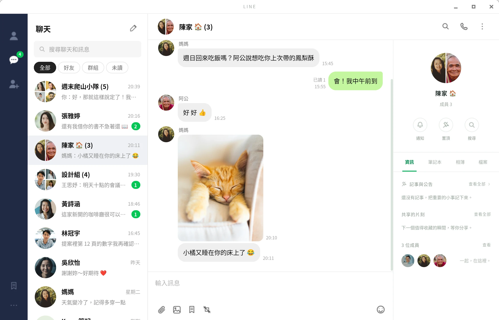

<div align="center">

# LINE for Linux

**Use LINE on Linux, natively. No Wine, no virtual machine, no browser tab.**

A native GTK 4 desktop client · end-to-end encrypted · laid out like the official LINE PC app

**English** · [繁體中文](README.zh-TW.md)

[](https://github.com/Elliot9/line-desktop/releases/latest)
[](https://github.com/Elliot9/line-desktop/releases)

[](LICENSE)

**[Download](https://github.com/Elliot9/line-desktop/releases/latest)** · [Install](#install) · [What's new](CHANGELOG.md) · [Guide](docs/GUIDE.md)

<picture>
  <source media="(prefers-color-scheme: dark)" srcset="docs/images/chat-dark.webp">
  
</picture>

</div>

> [!NOTE]
> This is an unofficial client. It is not made, endorsed or supported by LY Corporation (LINE). The app's interface is in Traditional Chinese.

## Why

LINE only ships for Windows and macOS. On Linux that has meant the Windows app under Wine or the Chrome extension. LINE for Linux is written from scratch for the Linux desktop instead.

| | LINE for Linux | Windows app in Wine | Chrome extension |
| --- | :---: | :---: | :---: |
| Native window, system fonts and input methods | ✅ | ⚠️ often broken | ✅ |
| Desktop notifications and an unread count on the dock | ✅ | ⚠️ | ⚠️ |
| Runs without a browser open | ✅ | ✅ | ❌ |
| Updates itself when you agree to | ✅ | ⚠️ updates can break it | ✅ |

## Features

- 💬 **Chats and groups** with unread counts, pins, mute, search, drafts, replies, unsend, read receipts, and older messages as you scroll up.
- 🔒 **End-to-end encrypted** with LINE's Letter Sealing. It talks to LINE directly, with no server in between.
- 😊 **Your stickers and LINE emoji**, everything you own on your phone, with recents and search. Emoji mix with text, and friends' status messages show them too.
- 🖼️ **Photos, videos and files**: drag and drop, paste a picture, send a screenshot, and browse a chat's photos and videos in the viewer.
- 👥 **Friends** in the same sections as on your phone (favorites, groups, friends, official accounts), with profile and group cards.
- 🐧 **At home on the desktop**: notifications, the dock badge, dark mode, the app menu, LINE PC's keyboard shortcuts, and one-click updates.

## Screenshots

<table>
  <tr>
    <td width="50%"><br><sub>Photo viewer: browse a chat's photos and videos</sub></td>
    <td width="50%"><br><sub>Friends, groups and profile cards</sub></td>
  </tr>
  <tr>
    <td><br><sub>Chat info: notes, photos, files and members</sub></td>
    <td><br><sub>Dark mode, following your system</sub></td>
  </tr>
</table>

<sub>The screenshots use made-up people and conversations; the photos are stock photos from Unsplash (see <a href="scripts/screenshots/photos.json">credits</a>).</sub>

## Install

On a typical Intel or AMD computer:

```bash
curl -LO https://github.com/Elliot9/line-desktop/releases/latest/download/line-desktop-linux-amd64.tar.gz
tar -xzf line-desktop-linux-amd64.tar.gz
cd line-desktop
./line-app --install-menu   # add LINE to your app menu
./line-app                  # start
```

On ARM (a Raspberry Pi 5, an ARM laptop), use `arm64` instead of `amd64`.

Works on **Ubuntu 24.04+ and Debian 12+** and their derivatives (Linux Mint, Pop!_OS, Zorin, …), on x86_64 and ARM64.

> [!TIP]
> The first start installs any missing system packages (GTK 4, PyGObject, fonts, the keyring tools) and may ask for your `sudo` password. Keep the whole `line-desktop` folder.

Running from source, other distributions, updating and uninstalling are covered in the [guide](docs/GUIDE.md#install).

## Get started

1. Start LINE. A QR code appears on the right.
2. On your phone, open LINE's QR scanner (next to the search bar on the home tab) and scan it. If a PIN appears, enter it on the phone.
3. That's it. Leave **自動登入** (sign in automatically) ticked to skip this next time.

You can also sign in with your LINE email and password. Want a look first? `./line-app --demo` opens an offline demo that needs no account.

## Not supported yet

- Voice and video calls ([research notes](docs/BACKLOG.md))
- Adding friends, creating groups, OpenChat
- Editing messages, sending videos, playing voice messages
- History older than 14 days: LINE only gives desktop clients the last 14 days; older messages stay on your phone

More detail, including official accounts and very large groups (which LINE does not encrypt), is in [docs/STATUS.md](docs/STATUS.md).

## Privacy

**LINE for Linux connects to LINE's servers directly. Nothing goes through a third party, and nothing is collected.**

- Your login is kept in the system keyring (Secret Service). Your password is never stored.
- Local notes, Keep memos and settings stay in `~/.local/share/matrix-line`, readable only by you.
- The only other request is a check on GitHub for a new version, which carries no account data and can be turned off.

## FAQ

**Can LINE ban my account for this?**
It connects the same way as LINE's own Chrome extension. It is still unofficial, so weigh the risk yourself.

**Chinese shows as boxes, or emoji are missing?**
Install `fonts-noto-cjk` and `fonts-noto-color-emoji`; `./line-app --setup` does it for you.

**I have to sign in every time.**
The system keyring is probably not running or not unlocked. Outside GNOME, make sure `gnome-keyring` is installed and running.

More answers in the [guide](docs/GUIDE.md#faq).

## Contributing

Issues and pull requests are welcome. [CONTRIBUTING.md](CONTRIBUTING.md) explains the layout, the tests and how releases are made. When reporting a problem, include your distribution and the output of `./line-app --version`.

## Credits

- The LINE protocol and encryption come from [beeper/line](https://github.com/beeper/line) (MIT). See [THIRD_PARTY.md](THIRD_PARTY.md).
- Released under the [MIT License](LICENSE).

**This is an unofficial third-party client with no affiliation with, or endorsement by, LY Corporation (LINE).** LINE is a trademark of LY Corporation.
