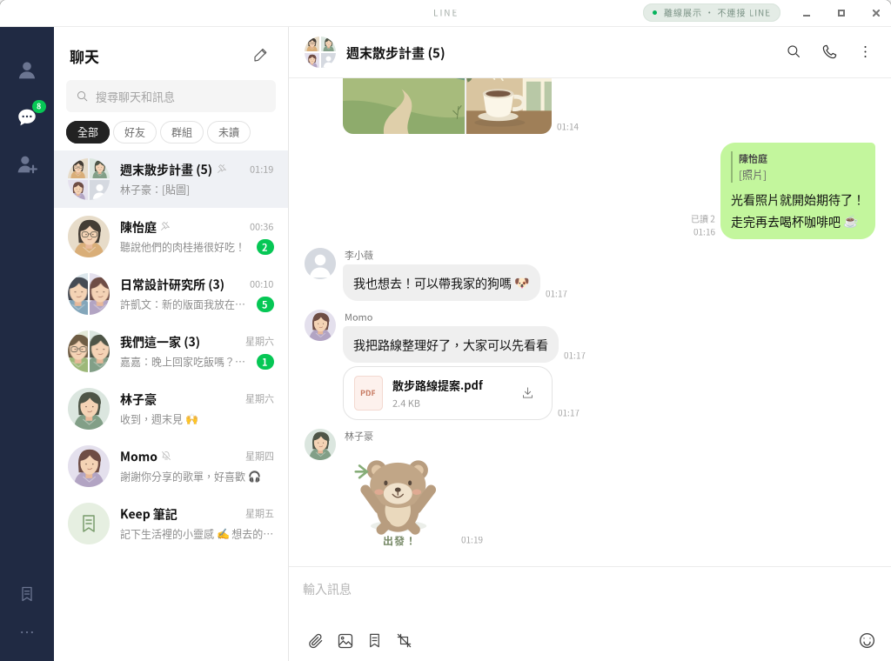
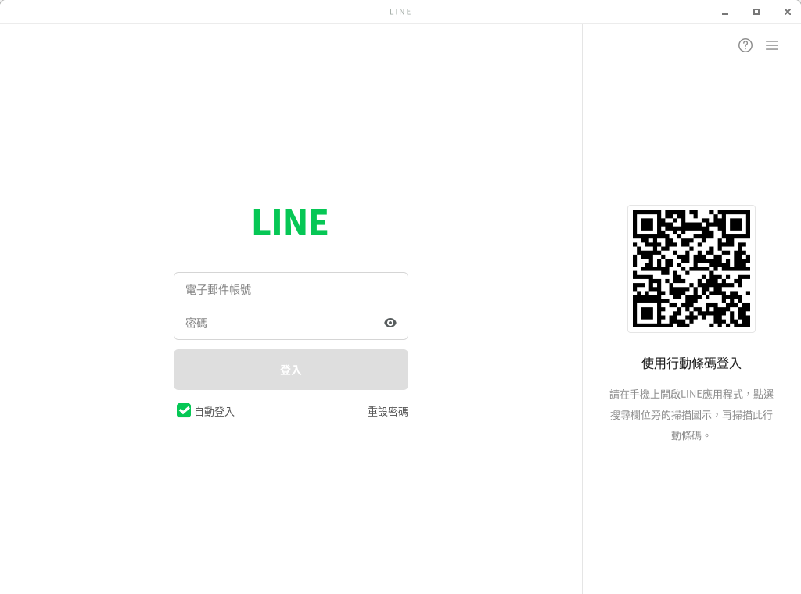
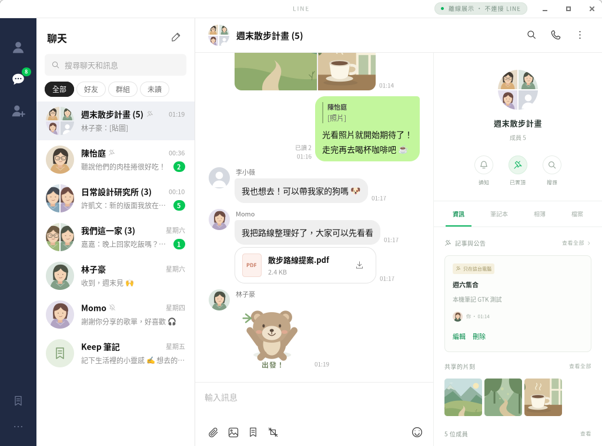
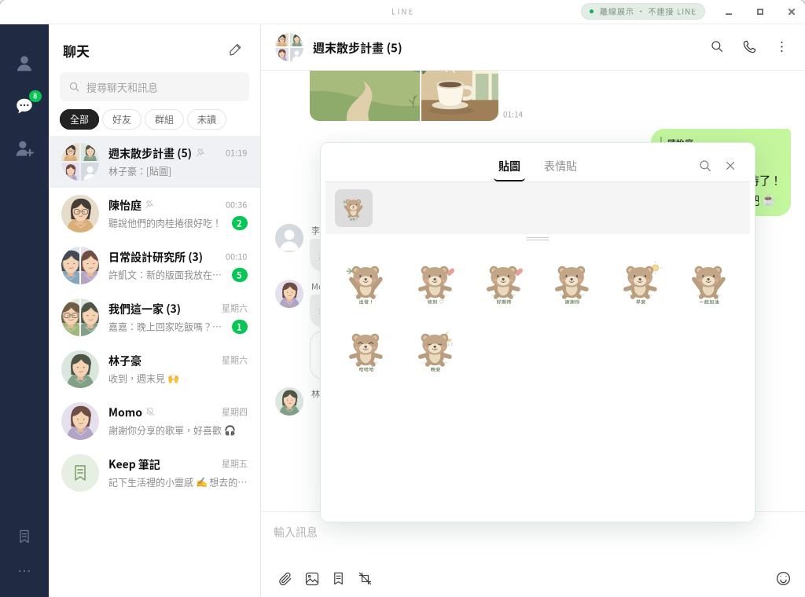
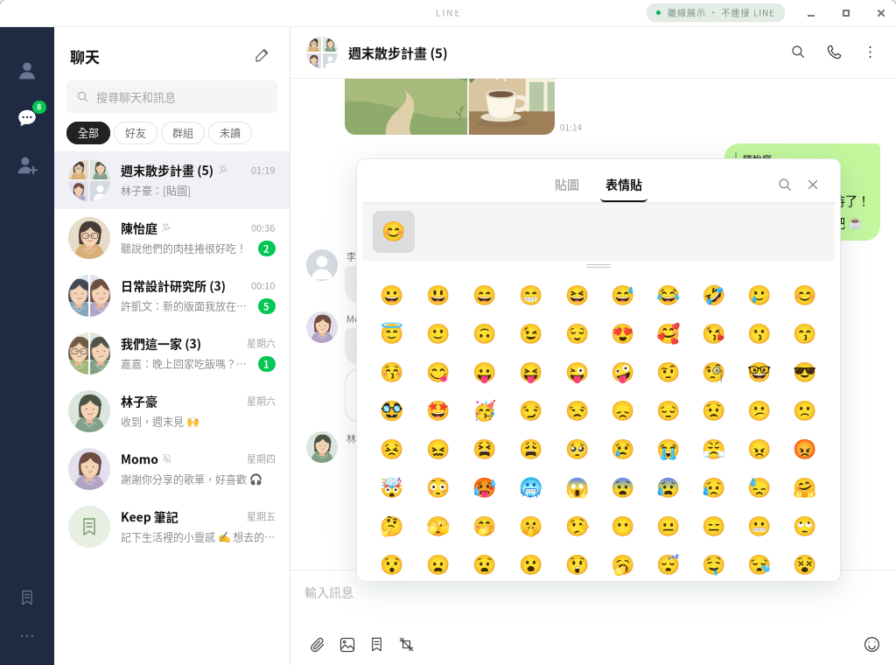
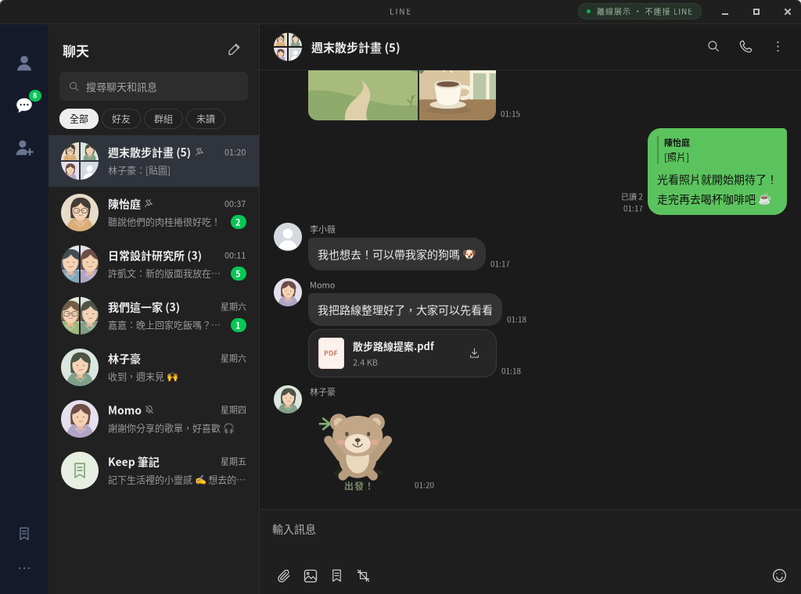
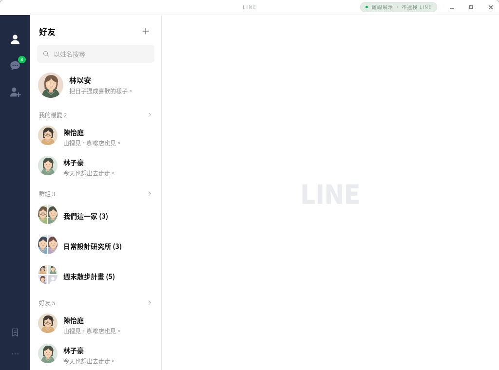

<div align="center">

# LINE for Linux

**在 Linux 上用 LINE，終於不必再開 Wine 或虛擬機。**

原生 GTK 4 桌面用戶端 · 端對端加密 · 介面對照官方 LINE PC 版

[](https://github.com/Elliot9/line-desktop/releases/latest)




*An unofficial native LINE desktop client for Linux (GTK 4). The UI is in Traditional Chinese.*

</div>

---

## 為什麼做這個

LINE 官方只有 Windows 與 macOS 版。在 Linux 上，大家只能用 Wine 跑 Windows 版（常常字型破碎、輸入法失靈、更新就壞），或開 Chrome 擴充功能（介面陽春、要一直開著瀏覽器）。

**LINE for Linux** 是從零寫起的原生 Linux 應用程式：

- 🐧 **真正的原生程式**：GTK 4 介面，跟系統字型、輸入法、深色主題、通知、鑰匙圈整合。沒有 Wine，也沒有內嵌瀏覽器。
- 🔒 **端對端加密**：使用 LINE 的 Letter Sealing 加密收發訊息，直接連到 LINE，不經過任何第三方伺服器。
- 💚 **熟悉的介面**：版面、配色、貼圖面板、登入畫面都對照官方 LINE PC 版，打開就會用。

## 功能

| | |
| --- | --- |
| **登入** | QR Code 掃描登入（自動產生）、電子郵件與密碼登入、手機 PIN 驗證、自動登入（存在系統鑰匙圈） |
| **聊天** | 私訊與群組、未讀數、置頂、靜音、搜尋聊天與訊息、草稿保存 |
| **訊息** | 文字、回覆、收回、已讀狀態、複製、轉傳、對話內搜尋 |
| **貼圖與表情貼** | 你在手機上擁有的所有貼圖與 **LINE 表情貼**、最近使用、搜尋貼圖包；表情貼可以和文字混在同一則訊息 |
| **照片與檔案** | 收發照片與檔案、拖放、直接貼上剪貼簿圖片、螢幕截圖後傳送、圖片檢視器 |
| **好友** | 我的最愛、群組、好友、官方帳號分區，與手機上的清單一致；個人檔案卡 |
| **桌面整合** | 系統通知、深色模式（跟隨系統或手動切換）、應用程式選單與 dock 圖示、LINE PC 版快捷鍵 |
| **本機小工具** | 聊天室記事、Keep 筆記（只存在這台電腦） |

## 截圖

<table>
  <tr>
    <td width="50%"><br><sub>登入：QR Code 或電子郵件</sub></td>
    <td width="50%"><br><sub>聊天室資訊：記事、相簿、檔案、成員</sub></td>
  </tr>
  <tr>
    <td><br><sub>貼圖面板：點一下就送出</sub></td>
    <td><br><sub>表情貼：基本表情與你擁有的 LINE 表情貼</sub></td>
  </tr>
  <tr>
    <td><br><sub>深色模式</sub></td>
    <td><br><sub>好友列表</sub></td>
  </tr>
</table>

<sub>截圖為內建的「離線展示」模式，人物與對話都是虛構的。</sub>

## 安裝

### 系統需求

- **Ubuntu 24.04 以上**或 **Debian 12 以上**（含 Linux Mint、Pop!_OS、Zorin 等衍生版）
- x86_64（一般 Intel／AMD 電腦）或 ARM64
- 需要系統鑰匙圈（GNOME 預設就有）才能自動登入；沒有也能用，只是每次都要重新登入。

### 方法一：下載安裝包（推薦）

一般 Intel／AMD 電腦：

```bash
curl -LO https://github.com/Elliot9/line-desktop/releases/latest/download/line-desktop-linux-amd64.tar.gz
tar -xzf line-desktop-linux-amd64.tar.gz
cd line-desktop
./line-app --install-menu   # 加入應用程式選單，之後可從選單開啟
./line-app                  # 啟動
```

ARM 電腦（例如 Raspberry Pi 5、ARM 筆電）把上面的 `amd64` 換成 `arm64`。

- 第一次啟動會自動安裝缺少的系統套件（GTK 4、PyGObject、字型、鑰匙圈工具），**可能會要求輸入 `sudo` 密碼**。
- 安裝包已內含編譯好的通訊核心，不需要安裝 Go。
- 請保留整個 `line-desktop` 資料夾。如果之後搬移資料夾，重新執行一次 `./line-app --install-menu`。

### 方法二：從原始碼執行

```bash
git clone https://github.com/Elliot9/line-desktop.git
cd line-desktop
./line-app
```

從原始碼執行時，第一次啟動會額外下載經 SHA256 驗證的 Go 工具鏈並編譯核心，需要幾分鐘與約 3 GB 可用記憶體。之後啟動會使用快取。

### 其他發行版

自動安裝只支援 apt。Fedora、Arch 等請先自行安裝對應套件再執行 `./line-app`：Python 3、PyGObject、GTK 4、librsvg、libsecret（`secret-tool`）、gnome-keyring、curl、Noto CJK 與 Noto Color Emoji 字型。完整清單見 [setup-debian.sh](scripts/setup-debian.sh)。

### 更新與移除

- **更新**：下載新版安裝包解壓縮覆蓋，或在原始碼資料夾執行 `git pull`。登入狀態與設定會保留。
- **移除**：刪除 `line-desktop` 資料夾、`~/.local/share/matrix-line`（本機資料），以及 `~/.local/share/applications/org.matrixline.Desktop.*.desktop`。

## 開始使用

1. 開啟後，畫面右邊會出現 QR Code。
2. 在手機 LINE 開啟 QR Code 掃描器（主頁搜尋列旁的掃描圖示），掃描畫面上的 QR Code。
3. 如果出現 PIN 碼，在手機上輸入同樣的數字。
4. 完成！勾選「自動登入」，下次開啟就會直接進入。

也可以在左邊輸入 LINE 帳號的電子郵件與密碼登入。

> **想先看看長怎樣？** 執行 `./line-app --demo` 開啟離線展示，不會連到 LINE，也不需要帳號。

### 快捷鍵

| 按鍵 | 動作 |
| --- | --- |
| `Enter` | 傳送訊息（可在設定改成 `Alt+Enter` 傳送） |
| `Ctrl+1`／`Ctrl+2`／`Ctrl+3` | 好友／聊天／加入好友 |
| `Ctrl+Tab`／`Ctrl+Shift+Tab` | 下一個／上一個聊天 |
| `Ctrl+F` | 在目前對話中搜尋 |
| `Ctrl+Shift+F` | 搜尋聊天 |
| `Ctrl+Shift+S` | 擷取螢幕畫面並傳送 |
| `Ctrl+V` | 貼上圖片 |
| `Ctrl+W` | 關閉目前對話 |
| `Ctrl+R` | 重新整理 |

## 目前的限制

這是非官方用戶端，以下功能 LINE 的協定目前做不到，或還沒實作：

- 語音與視訊通話
- 新增好友、建立群組、社群（OpenChat）
- 編輯訊息、載入更早的聊天記錄（只會顯示近期訊息）
- 記事與 Keep 筆記只存在本機，不會同步到手機

另外：

- **Letter Sealing 必須開啟**（LINE 預設開啟）。為了安全，訊息不會改用未加密的方式傳送。
- **與 LINE Chrome 擴充功能共用登入名額**：登入這個程式可能讓 Chrome 擴充功能登出，反之亦然（[上游已知問題](https://github.com/beeper/line#known-issues)）。手機與官方 PC／Mac 版不受影響。

各功能的詳細狀態見 [功能狀態](docs/STATUS.md)。

## 隱私與安全

- 程式**直接連線到 LINE 的伺服器**，不經過任何第三方，也不收集任何資料。
- 登入憑證存放在系統鑰匙圈（Secret Service）；取消「自動登入」時不會寫入。**密碼從不儲存。**
- 本機資料（記事、Keep 筆記、偏好設定）存放在 `~/.local/share/matrix-line`，檔案權限為僅限本人讀寫。
- 全部原始碼都在這裡，歡迎檢查。

## 常見問題

**這會被 LINE 封鎖帳號嗎？**
程式使用與 LINE Chrome 擴充功能相同的連線方式。但這不是官方程式，請自行評估風險。

**中文是方塊，或表情符號顯示不出來？**
請安裝 `fonts-noto-cjk` 與 `fonts-noto-color-emoji`（`./line-app --setup` 會自動安裝）。

**每次開啟都要重新登入？**
系統鑰匙圈可能沒有啟動或沒有解鎖。GNOME 以外的桌面環境請確認已安裝並啟動 `gnome-keyring`，並勾選登入頁的「自動登入」。

**支援 Wayland 嗎？**
支援，Wayland 與 X11 都可以用。

## 開發

```
line-app      啟動腳本：安裝相依套件、建置核心、啟動介面
desktop/      GTK 4 介面（Python + PyGObject）
core/         通訊核心（Go），負責 LINE 協定與加密
scripts/      建置、打包、測試
```

介面與核心之間用 JSON 行協定溝通，細節見 [架構說明](docs/ARCHITECTURE.md)。

```bash
cd core && go test ./... && cd ..                            # 核心測試
python3 scripts/check-core.py .build/line-core-linux-amd64   # 核心協定檢查
scripts/gui-smoke.sh            # GUI 自動檢查（需要 xvfb xauth dbus-x11 imagemagick）
scripts/package.sh amd64        # 打包到 dist/，附 SHA256
```

歡迎提出 Issue 與 Pull Request！回報問題時，請附上發行版版本與 `./line-app --version` 的輸出。

## 致謝與聲明

- LINE 通訊協定與加密使用 [beeper/line](https://github.com/beeper/line)（MIT 授權），詳見 [第三方聲明](THIRD_PARTY.md)。
- 介面中的插畫、人物與小熊貼圖為本專案原創。

**本專案是非官方的第三方用戶端，與 LY Corporation（LINE）沒有任何關係，也未獲其認可。** LINE 是 LY Corporation 的商標。
