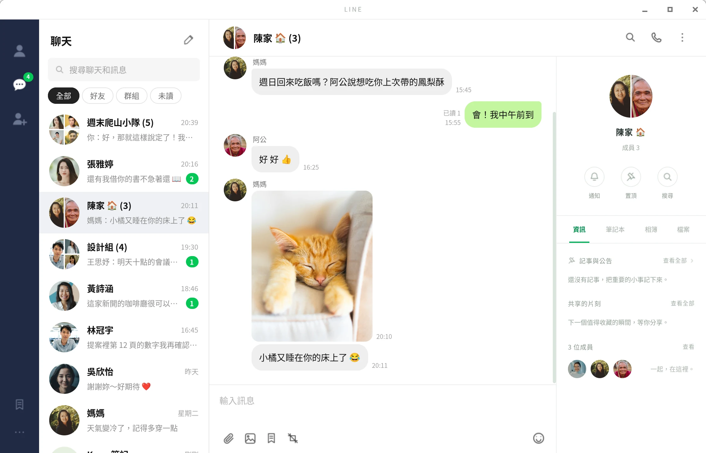
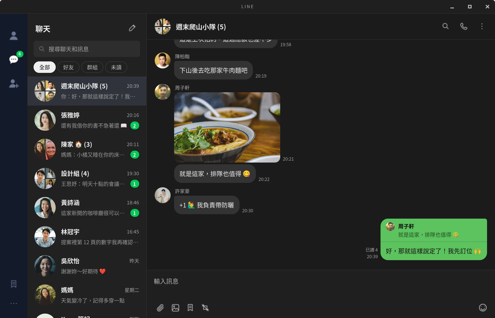

<div align="center">

# LINE for Linux

**在 Linux 上用 LINE，終於不必再開 Wine、虛擬機或瀏覽器分頁。**

原生 GTK 4 桌面用戶端 · 端對端加密 · 版面對照官方 LINE PC 版

[English](README.md) · **繁體中文**

[](https://github.com/Elliot9/line-desktop/releases/latest)
[](https://github.com/Elliot9/line-desktop/releases)

[](LICENSE)

**[下載最新版](https://github.com/Elliot9/line-desktop/releases/latest)** · [安裝](#安裝) · [更新紀錄](CHANGELOG.md) · [使用說明](docs/GUIDE.zh-TW.md)

<picture>
  <source media="(prefers-color-scheme: dark)" srcset="docs/images/chat-dark.webp">
  
</picture>

</div>

> [!NOTE]
> 這是非官方用戶端，與 LY Corporation（LINE）無關，也未獲其認可或支援。

## 為什麼選它

LINE 官方只有 Windows 與 macOS 版。在 Linux 上，過去只能用 Wine 跑 Windows 版，或開 Chrome 擴充功能。LINE for Linux 是從零為 Linux 桌面寫的原生程式。

| | LINE for Linux | Wine 跑 Windows 版 | Chrome 擴充功能 |
| --- | :---: | :---: | :---: |
| 原生視窗，系統字型與輸入法 | ✅ | ⚠️ 常常出問題 | ✅ |
| 桌面通知、dock 圖示顯示未讀數 | ✅ | ⚠️ | ⚠️ |
| 不用開著瀏覽器 | ✅ | ✅ | ❌ |
| 有新版本時由你決定一鍵更新 | ✅ | ⚠️ 更新常會壞 | ✅ |

## 功能

- 💬 **聊天與群組**：未讀數、置頂、靜音、搜尋、草稿、回覆、收回、已讀，往上捲動就能載入更早的訊息。
- 🔒 **端對端加密**：使用 LINE 的 Letter Sealing，直接連到 LINE，不經過任何中間伺服器。
- 😊 **你的貼圖與表情貼**：手機上擁有的都能用，有最近使用與搜尋；表情貼可以和文字混排，好友狀態訊息裡的表情貼也會顯示。
- 🖼️ **照片、影片與檔案**：拖放、貼上圖片、截圖後傳送，在檢視器裡瀏覽聊天中的照片與影片。
- 👥 **好友**：與手機相同的分區（我的最愛、群組、好友、官方帳號），有個人檔案卡與群組資訊卡。
- 🐧 **融入桌面**：系統通知、dock 未讀數、深色模式、應用程式選單、LINE PC 版快捷鍵、一鍵更新。

## 截圖

<table>
  <tr>
    <td width="50%"><br><sub>照片檢視器：瀏覽聊天中的照片與影片</sub></td>
    <td width="50%"><br><sub>好友、群組與個人檔案卡</sub></td>
  </tr>
  <tr>
    <td><br><sub>聊天室資訊：記事、相簿、檔案、成員</sub></td>
    <td><br><sub>深色模式，跟隨系統設定</sub></td>
  </tr>
</table>

<sub>截圖中的人物與對話都是虛構的；照片是 Unsplash 的圖庫照片（<a href="scripts/screenshots/photos.json">出處</a>）。</sub>

## 安裝

一般 Intel／AMD 電腦：

```bash
curl -LO https://github.com/Elliot9/line-desktop/releases/latest/download/line-desktop-linux-amd64.tar.gz
tar -xzf line-desktop-linux-amd64.tar.gz
cd line-desktop
./line-app --install-menu   # 加入應用程式選單
./line-app                  # 啟動
```

ARM 電腦（Raspberry Pi 5、ARM 筆電）把 `amd64` 換成 `arm64`。

支援 **Ubuntu 24.04 以上、Debian 12 以上**及其衍生版（Linux Mint、Pop!_OS、Zorin 等），x86_64 與 ARM64。

> [!TIP]
> 第一次啟動會自動安裝缺少的系統套件（GTK 4、PyGObject、字型、鑰匙圈工具），可能會要求輸入 `sudo` 密碼。請保留整個 `line-desktop` 資料夾。

從原始碼執行、其他發行版、更新與移除，見[使用說明](docs/GUIDE.zh-TW.md#安裝)。

## 開始使用

1. 開啟 LINE，畫面右邊會出現 QR Code。
2. 用手機 LINE 的 QR Code 掃描器（主頁搜尋列旁的圖示）掃描；如果出現 PIN 碼，在手機上輸入。
3. 完成！勾選「自動登入」，下次開啟就會直接進入。

也可以用 LINE 帳號的電子郵件與密碼登入。想先看看長怎樣？執行 `./line-app --demo` 開啟離線展示，不需要帳號。

## 還不支援

- 語音與視訊通話（[調查記錄](docs/BACKLOG.md)）
- 新增好友、建立群組、社群（OpenChat）
- 編輯訊息、傳送影片、播放語音訊息
- 超過 14 天的聊天記錄：LINE 只提供電腦版最近 14 天的訊息，更早的只在手機上

更多細節，包括官方帳號與超大群組（LINE 本身就不替它們加密），見[功能狀態](docs/STATUS.md)。

## 隱私

**程式直接連線到 LINE 的伺服器，不經過任何第三方，也不收集任何資料。**

- 登入憑證存放在系統鑰匙圈（Secret Service），密碼從不儲存。
- 本機的記事、Keep 筆記與設定存放在 `~/.local/share/matrix-line`，只有你能讀寫。
- 唯一的其他連線是向 GitHub 查詢有沒有新版本，不帶任何帳號資料，可以在設定關閉。

## 常見問題

**這會被 LINE 封鎖帳號嗎？**
程式使用與 LINE 官方 Chrome 擴充功能相同的連線方式。但它仍是非官方程式，請自行評估風險。

**中文是方塊，或表情符號顯示不出來？**
請安裝 `fonts-noto-cjk` 與 `fonts-noto-color-emoji`（`./line-app --setup` 會自動安裝）。

**每次開啟都要重新登入？**
系統鑰匙圈可能沒有啟動或沒有解鎖。GNOME 以外的桌面請確認已安裝並啟動 `gnome-keyring`。

更多問答見[使用說明](docs/GUIDE.zh-TW.md#常見問題)。

## 參與開發

歡迎提出 Issue 與 Pull Request。專案結構、測試與發版流程見 [CONTRIBUTING.md](CONTRIBUTING.md)。回報問題時，請附上發行版版本與 `./line-app --version` 的輸出。

## 致謝與聲明

- LINE 通訊協定與加密使用 [beeper/line](https://github.com/beeper/line)（MIT 授權），詳見[第三方聲明](THIRD_PARTY.md)。
- 本專案以 [MIT 授權](LICENSE)釋出。

**本專案是非官方的第三方用戶端，與 LY Corporation（LINE）沒有任何關係，也未獲其認可。** LINE 是 LY Corporation 的商標。
