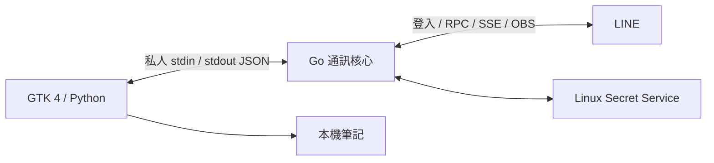

# 原生 Linux LINE 用戶端的分工

`beeper/line` 本身是 LINE 與 Matrix 之間的橋接器。這個專案只使用它的 `pkg/line`、`pkg/e2ee` 與 Go 加密執行器，將 Matrix 特有的服務與資料模型留在原專案。

`desktop/app.py` 建立原生 GTK 元件，`desktop/model.py` 管理畫面資料與本機筆記。`desktop/ipc.py` 在背景執行緒讀寫通訊管道，再由 GLib 主執行緒更新畫面。桌面程式使用 `Gtk.Application`，正式模式與示範模式各自只有一個實例。

`core/main.go` 以單一事件迴圈持有登入、金鑰與訊息狀態。登入與 SSE 在可取消的背景工作執行，結果帶有工作階段編號，已取消的工作不能還原舊帳號。UI 的附件視窗也會在登出時關閉，並拒絕舊工作階段的回呼。

`core/auth.go` 在登入的加密執行器關閉前匯出金鑰，再建立日常收發用的管理器。同一帳號重新登入時合併歷史金鑰。`core/session.go` 透過 `secret-tool` 的標準輸入保存憑證，token 不會放在命令列、UI 或一般檔案中。

`core/live.go` 處理聊天、訊息與群組金鑰。`core/sync.go` 持有 SSE 版本與重連時機。無法建立 Letter Sealing 通道時拒絕發送；傳送結果不明時不自動重試，避免重複訊息。

`core/internal/attachments` 處理貼圖資料與檔案加密格式。檔案的 key material 放在加密訊息內，不放在一般 metadata 或 UI 資料中。接收檔案先驗證 HMAC，再寫入私人暫存檔，最後以不覆寫既有目的檔案的方式完成儲存。

上游固定於 `a9cefaf244d17f7bb6fb9685cdfd3ccf993c3293`。升級前需要重新確認登入、媒體流程及加密協定；`go.mod` 與 `go.sum` 不會在啟動時自動升版。
