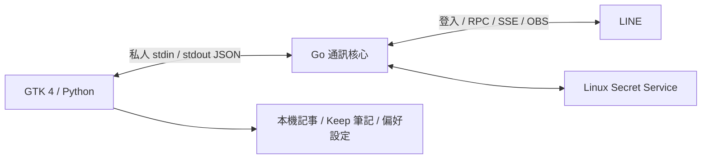

# 原生 Linux LINE 用戶端的分工

`beeper/line` 本身是 LINE 與 Matrix 之間的橋接器。這個專案只使用它的 `pkg/line`、`pkg/e2ee` 與 Go 加密執行器，將 Matrix 特有的服務與資料模型留在原專案。

`desktop/app.py` 建立原生 GTK 元件，結構與 `index.html` 的 DOM 一一對應；`desktop/assets/style.css` 是限定在程式視窗內的 CSS 轉寫，原生檔案對話框維持系統外觀。`desktop/art.py` 移植 `index.html` 的 SVG 圖示、人物、風景與小熊貼圖，經 GdkPixbuf 繪製並依 CSS 顏色著色；`desktop/ui.py` 提供對應 HTML 元素的小型建構函式。`desktop/model.py` 管理畫面資料，以及只存在本機的記事、Keep 筆記與偏好設定。`desktop/ipc.py` 在背景執行緒讀寫通訊管道，再由 GLib 主執行緒更新畫面。桌面程式使用 `Gtk.Application`，正式模式與示範模式各自只有一個實例。

`core/main.go` 以單一事件迴圈持有登入、金鑰與訊息狀態。登入與 SSE 在可取消的背景工作執行，結果帶有工作階段編號，已取消的工作不能還原舊帳號。UI 的附件視窗也會在登出時關閉，並拒絕舊工作階段的回呼。

`core/auth.go` 在登入的加密執行器關閉前匯出金鑰，再建立日常收發用的管理器。同一帳號重新登入時合併歷史金鑰。`core/session.go` 透過 `secret-tool` 的標準輸入保存憑證，token 不會放在命令列、UI 或一般檔案中。

`core/live.go` 處理聊天、訊息與群組金鑰。`core/sync.go` 持有 SSE 版本與重連時機。無法建立 Letter Sealing 通道時拒絕發送；傳送結果不明時不自動重試，避免重複訊息。

## 同步與事件

串流每次都從 LINE 目前的 revision 開始，revision 不保存到鑰匙圈：離線期間的未讀數與最後一則訊息由聊天清單快照提供，對話內容在開啟聊天時才向 LINE 取得。串流沉默超過 5 分鐘後重連（例如電腦休眠後），核心不重播這段期間的操作，而是重新取得 revision、清空訊息快取並重新整理清單，同時送出 `resync` 事件，介面據此丟棄舊的對話內容並重新載入開啟中的聊天。清單重新整理失敗時會自動重試。

事件迴圈把串流送來的訊息先收進緩衝，短暫等待後一次以 `messages` 事件送出，並附上有變動的聊天列（`chats`）；只有聊天列變動時（已讀、收回）單獨送出 `chats` 事件。完整快照（`snapshot`）只在登入、重新整理、重新同步與刪除聊天時送出。未讀數一律以核心送出的聊天列為準，介面不自行累計。

已讀：串流的已讀通知（op 55）只涵蓋程式執行之後的閱讀。開啟聊天（`messages.list`）時，核心同時向 LINE 取得各成員的已讀範圍（`getMessageReadRange`，最多等 5 秒，失敗只是少顯示已讀），併入聊天的 `read_by` 並隨訊息回覆；重新整理清單時保留已知的已讀時間。

解密群組訊息時先使用已有的金鑰，缺少時才向 LINE 取得；一批訊息需要的金鑰會並行取得，取不到的金鑰在 20 秒內不重複詢問。

## 照片與背景工作

照片不經 JSON 管道傳送。`core/media.go` 把解密後的照片寫入 `XDG_RUNTIME_DIR/matrix-line/media-*`（記憶體檔案系統；目錄 0700、檔案 0600、總量上限 128 MiB），只回覆檔案路徑。這個目錄在登出、重新同步與核心結束時刪除；核心啟動時會清掉先前異常結束留下的目錄（以檔案鎖判斷是否仍有核心在使用）。訊息被收回時，對應的照片一併刪除。

下載、上傳與貼圖清單在背景工作執行，完成後才回覆請求，事件迴圈在這段期間照常收發訊息。背景工作不接觸核心狀態，結果回到事件迴圈後才套用；工作階段已變更時仍會回覆（錯誤），讓介面的等待結束。媒體主機回覆的錯誤不視為登入失效；更新憑證時若只是網路不通，保留工作階段稍後重試。

## 介面的傳輸與繪製

`desktop/ipc.py` 的讀取執行緒把核心送來的每一行放進有上限的佇列，主迴圈每次只處理數毫秒就讓出，讓 GTK 繪製與處理輸入；介面跟不上時讀取執行緒停止讀取，核心便在管道上等待，不會把積壓堆在記憶體裡。佇列中已被較新快照取代的快照會略過。

`desktop/app.py` 把核心事件引起的重繪合併：單一事件立即繪製，連續事件至少間隔 80 毫秒。側邊列表只建立靠近頂端的列，其餘在捲動時才建立；新訊息直接附加在對話尾端，不重建整段對話。`desktop/photos.py` 在工作執行緒解碼照片，縮圖以顯示尺寸解碼。大頭貼與貼圖同樣在工作執行緒解碼。

通知以批次處理：同一批訊息每個聊天最多一則，5 秒內超過 4 則時改為一則摘要。手機上已靜音的聊天不通知。

通知經由 `org.freedesktop.Notifications` 送出（`desktop/__main__.py` 設定 `GNOTIFICATION_BACKEND`），而非 GNOME 上 GLib 預設的 `org.gtk.Notifications`：GNOME 會保存後者並在每次登入桌面時還原，dock 圖示因此在 LINE 開啟前就顯示數字。freedesktop 通知在 LINE 結束時由 GNOME 移除。介面記錄目前顯示中的通知，聊天的未讀歸零（在這台電腦或手機上讀過、標為已讀、靜音）就收回；舊版留下的 `org.gtk.Notifications` 通知在第一次載入聊天清單時收回一次。

dock 圖示上的未讀數以 Unity LauncherEntry 的 `Update` 訊號送出（`com.canonical.Unity.LauncherEntry`，Ubuntu Dock、Dash to Dock 與 KDE 都會讀取），數字與側邊欄「聊天」相同。Ubuntu Dock 收到這個數字後就顯示它，不再以通知數量當作數字；LINE 結束、離開 D-Bus 時 dock 自動移除。Ubuntu Dock 在解除螢幕鎖定時會重新啟動並遺失數字，所以介面在解鎖與視窗取得焦點時再送一次。

右鍵選單掛在視窗的最上層，而不是聊天列或訊息泡泡底下，列的樣式不會套到選單，重繪列表也不會連帶關閉選單。選單從指標位置向右下展開。訊息文字可以選取，右鍵由泡泡先取得，因此出現的是 LINE 的選單而不是 GTK 的文字選單；選取部分文字時「複製」只複製選取的部分。

`desktop/launcher.py` 產生應用程式選單的 `.desktop` 檔。dock 選單提供「結束 LINE」（`line-app --quit` 請執行中的實例結束），因為關閉視窗只會隱藏。程式啟動時，若已安裝的啟動器來自同一個資料夾且內容過時，會自動更新。

`core/internal/attachments` 處理貼圖資料與檔案加密格式。檔案的 key material 放在加密訊息內，不放在一般 metadata 或 UI 資料中。接收檔案先驗證 HMAC，再寫入私人暫存檔，最後以不覆寫既有目的檔案的方式完成儲存。

上游固定於 `a9cefaf244d17f7bb6fb9685cdfd3ccf993c3293`。升級前需要重新確認登入、媒體流程及加密協定；`go.mod` 與 `go.sum` 不會在啟動時自動升版。
